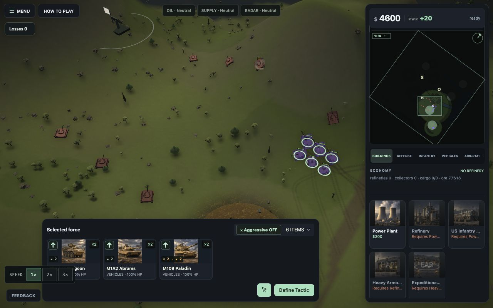

# Movement polish

Separate branch `feat/movement-targeting-polish`, based on the deployed selection release `c4ba0c775a24ed8fcfdec830da002381cdd3e0a1` (PR #133).

## Movement

A reproduced 36-tank flat-map order left two tanks circling the group anchor after 80 simulated seconds. Shared flow fields pointed at the group center, while their assigned formation slots lay beyond the fixed 18m direct-steering zone. The arrival zone now accounts for the formation offset, with a walkable-segment check before direct steering. If an obstructed slot leaves a unit at the shared field’s zero gradient, that unit hands off to a field for its own slot. This preserves routes and avoids rebuilding fields for every unit on every tick. No teleport, speed buff or obstacle bypass is introduced.

Intermediate route arrivals retain momentum for hold and attack-move end actions as well as attack-through. The final waypoint still stops normally. A disconnected flow field appears as “⚠ N blocked” in the small status line beneath a selected unit-group thumbnail; opening the route allows movement to resume. This indicates an unreachable path, not temporary traffic jams or every case of a physically stuck unit.

## Attack feedback

The prominent persistent colored lines, target rings and target names/counts were removed after local review. Attack orders retain the existing brief order marker. Existing compact group attacking counts use combat eligibility rather than stale weapon target IDs; no extra target overlay is rendered.

## Local review

http://127.0.0.1:5191/?start=skirmish&armies=2&tank-combat-test=1&durable-targets=1&seed=231129&doctrines=expeditionary-force,missile-command&review=movement

The existing local scenario gives six selected friendly vehicles, unarmed enemy targets and disabled enemy AI. Durable targets are a local fixture option. Right-click an enemy to order an attack; the ordinary brief order marker confirms it. Draw replacement routes, change formation, or press X to stop. Normal gameplay is available at `/?start=skirmish&armies=2`.

## Evidence and performance limits

CPU comparison against deployed main `c4ba0c7`: same flat 96×96-cell map, 36 tanks, one group order, 2,400 simulation ticks (80s). Ten alternating trials, three warmups discarded, seven measured medians:

| Metric | Before | After |
| --- | ---: | ---: |
| Units reaching their slots | 34 / 36 | 36 / 36 |
| Cumulative 2,400-tick CPU time | 23.134 ms | 21.675 ms |

The timing is cumulative Node CPU work, excluding browser rendering and GPU time, not an FPS guarantee. [Samples](movement-cpu.txt), [fixture source](movement-cpu.ts.txt).

The rare obstructed-slot fallback can require a new flow-field build. Full-battle, large obstructed formations and physical mobile devices have not been benchmarked. Existing flow-field caching remains in use; no global repath loop, new postprocessing, lights, shadows or dependencies.

## Validation

Full suite after overlay removal: 1,011 tests / 135 files pass; production build passes with the existing bundle-size advisory. Coverage retains deterministic 36-unit arrival, an obstructed formation slot with no blocked-cell crossing, momentum for three end actions, stale-target eligibility/range/read-only behavior, and blocked-route recovery.

User approved this release for merge and production deployment.

## Water destination feedback

Ground movement requests with a waypoint in water are rejected before they can be silently snapped onto land. Aircraft remain eligible in mixed selections; accepted command counts use actual recipients. Ordinary clicks, radar moves and tactic/planner execution share this check. A local WeakMap retains the rejection reason without changing the previous order or adding simulation/save/network fields. Valid land orders, stop or another attack clear the warning. Finishing a previous valid order does not immediately erase the water warning.

Selected-force feedback now has a visible ROUTE BLOCKED notice, with separate counts for water rejections and unreachable paths. Temporary traffic jams are still not detected as blocked routes. Browser verified a lake click, land-order clearing and Quick Tactic water rejection; the final rejection-lifetime correction is covered by unit tests. No more preview changes were requested before deployment.
