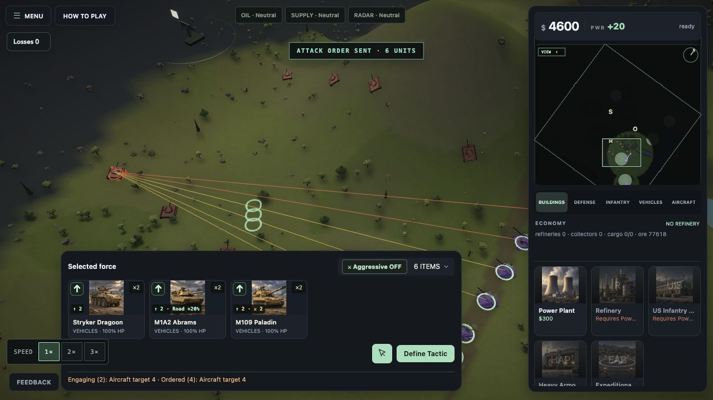

# Movement and targeting polish

Separate branch `feat/movement-targeting-polish`, based on the deployed selection release `c4ba0c775a24ed8fcfdec830da002381cdd3e0a1` (PR #133).

## Movement

A reproduced 36-tank flat-map order left two tanks circling the group anchor after 80 simulated seconds. Shared flow fields pointed at the group center, while their assigned formation slots lay beyond the fixed 18m direct-steering zone. The arrival zone now accounts for the formation offset, with a walkable-segment check before direct steering. If an obstructed slot leaves a unit at the shared field’s zero gradient, that unit hands off to a field for its own slot. This preserves routes and avoids rebuilding fields for every unit on every tick. No teleport, speed buff or obstacle bypass is introduced.

Intermediate route arrivals retain momentum for hold and attack-move end actions as well as attack-through. The final waypoint still stops normally. A disconnected flow field appears as “route blocked” in group status; opening the route allows movement to resume.

## Target feedback

Selected units show amber ordered targets and red eligible weapon engagements, with a ring at each visible target and names/counts in the selection bar. A read-only combat query reuses actual eligibility, range, minimum range and terrain-cover rules. Merely retaining a weapon target ID no longer implies an active engagement. Group attacking counts use the same query. Engagement means a valid target, not a hit confirmation or a promise that a turret has already finished aiming.

Hidden/dead targets are filtered before rendering or naming them. Selecting nothing clears feedback. Geometry is capped at 64 source/target records; all rings share one InstancedMesh and all connectors share one LineSegments buffer (two draws by source, with forceSinglePass on the planar rings). Updates use the existing 10Hz HUD cadence. Target statistics still cover the selected groups; no combat or acquisition rules change.

## Local review

http://127.0.0.1:5191/?start=skirmish&armies=2&tank-combat-test=1&durable-targets=1&seed=231129&doctrines=expeditionary-force,missile-command&review=movement

The existing local scenario gives six selected friendly vehicles, unarmed enemy targets and disabled enemy AI. Durable targets are a local fixture option. Right-click an enemy to order an attack; watch amber/red lines and target labels. Draw replacement routes, change formation, or press X to stop. Normal gameplay is available at `/?start=skirmish&armies=2`.

## Evidence and performance limits

CPU comparison against deployed main `c4ba0c7`: same flat 96×96-cell map, 36 tanks, one group order, 2,400 simulation ticks (80s). Ten alternating trials, three warmups discarded, seven measured medians:

| Metric | Before | After |
| --- | ---: | ---: |
| Units reaching their slots | 34 / 36 | 36 / 36 |
| Cumulative 2,400-tick CPU time | 23.134 ms | 21.675 ms |

The current 64-target collection plus combat eligibility query averaged 0.0241ms per HUD refresh across 1,000 iterations in a separate CPU fixture. These are Node measurements excluding rendering, geometry uploads, full selection-bar work and browser GPU time. They are not universal FPS guarantees. [Samples](movement-cpu.txt), [fixture source](movement-cpu.ts.txt).

The rare obstructed-slot fallback can require a new flow-field build. Full-battle, large obstructed formations and physical mobile devices have not been benchmarked. Existing flow-field caching remains in use; no global repath loop, new postprocessing, lights, shadows or dependencies.

## Validation

Full suite: 1,009 tests / 135 files pass; production build passes with the existing bundle-size advisory. New coverage checks deterministic 36-unit arrival, an obstructed formation slot with no blocked-cell crossing, momentum for three end actions, target alias deduplication/privacy/death/range, bounded buffer reuse, and blocked-route recovery. Independent review corrected planar ring single-pass configuration and inconsistent group attacking counts. Final wording tests pass separately. A fresh desktop browser session confirmed two eligible engagements and four still-ordered units, matching per-group attacking counts; X cleared the targeting feedback, with no console warnings/errors.

This PR is for local review; only the preceding selection PR is deployed.

