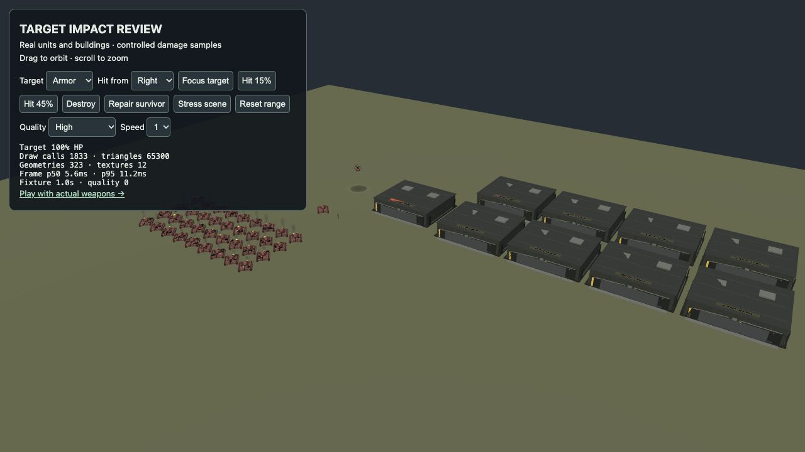
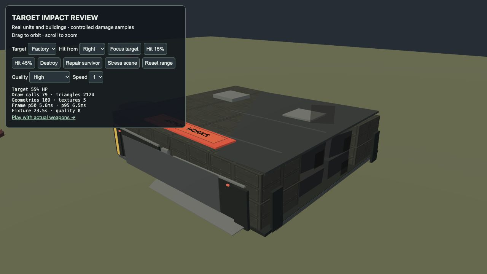

# Target impact presentation

This extends the missile presentation in draft PR #132 to the objects being hit. Simulation damage, targeting, reloads, collision, movement and multiplayer data are unchanged.

## Behavior

- Armor and aircraft receive incoming-direction surface scars and a brief cooling heat mark. Known model hull dimensions place marks on exposed surfaces without per-hit triangle raycasts. Three persistent scars share one instanced draw; full repair clears them.
- Buildings receive textured soot, cracks and irregular damage marks on the exposed facade or roof. Existing structural damage and collapse remain authoritative. Fire and smoke use small shared textures, and collapse carries effects toward the rubble rather than leaving facade marks floating.
- Debris distinguishes masonry, hot metal and small cloth/dust fragments. One preallocated instance pool replaces individually allocated fragment meshes. It is capped at 140/88/52 particles for High/Medium/Performance quality, with gravity, one ground bounce, cooling and expiry.
- Damaged building cells batch by their original geometry and material, preserving surface detail while reducing draw calls. Bounds update after matrix changes; shared model geometry/material ownership stays with the existing model cache.
- Heat follows simulation ticks, not rendering frequency. Collapse transforms refresh only when simulation progress changes. Fogged building effects freeze to avoid revealing unseen damage.

## Local review

Run `npm run dev -- --host 127.0.0.1 --port 5191`, then open http://127.0.0.1:5191/impact-review.html . Select Armor, Infantry, Aircraft or Factory; choose an incoming direction, apply 15%/45% damage, destroy, repair a survivor or reset. Orbit/zoom for inspection. This is a controlled renderer fixture using actual UnitView/BuildingView/CombatView, with prescribed damage rather than live combat logic. The page links to the actual-unit weapons lab for gameplay. The standalone review page is omitted from the default production build.

## Measured cost

Baseline is the previous PR revision `396b29eb5e09203cee6d0feeed2efbfeb0347011`, already including the missile improvements. Both browser scenes use the game’s existing single-pass flat-effect configuration, same camera, High quality and fixed time 1.0s. Fixture: 36 additional tanks at 24% HP, eight damaged factories at 40% HP, plus the default targets. URL: `/impact-review.html?stress=1&critical=1&snapshot=1`.

| Renderer counter | Previous PR | Target upgrade |
| --- | ---: | ---: |
| Draw calls | 1,833 | 981 |
| Triangles | 65,300 | 57,236 |
| Geometries | 323 | 321 |
| Textures | 12 | 15 |

About 46% fewer draws and 12% fewer triangles in this fixture. Four shared procedural 128×128 RGBA surface textures cost about 256 KiB raw storage; the old unit smoke texture is replaced when applicable. No added lights, shadows, postprocessing or texture animation uploads. Transparent pixels still cost GPU work. Both observed browser frame medians were 5.6ms, but refresh pacing prevents treating that as a GPU timing benchmark.

Node CPU fixture: 24 critically damaged tanks and eight damaged factories; view updates plus scene matrix propagation, initialization outside the timer. Ten alternating trials, three warmups discarded; median cumulative work across seven samples:

| Work | Previous PR | Target upgrade |
| --- | ---: | ---: |
| 120 steady updates | 22.18 ms | 19.22 ms |
| 90 collapse updates | 58.69 ms | 24.02 ms |

These are cumulative CPU durations, not FPS. Raw samples: [log](target-impact-cpu.txt), [fixture source](target-impact-cpu.test.ts.txt). Real mobile hardware, exact GPU timings and full-battle FPS are not established by these fixtures.

## Validation

997 tests / 130 files pass; production build passes with the existing bundle-size advisory. Eight new targeted tests cover instance matrices/material ownership, bounded debris storage and disposal, directional scars and repair, simulation-time heat, collapse material stability and fog freezing. Desktop browser checks covered factory damage/destruction, infantry/aircraft damage and quality/speed controls. Independent code review found no remaining blocker after correcting repair’s scar cursor reset.

The batching decisions follow the installed Three.js r170 implementation and official [InstancedMesh](https://threejs.org/docs/pages/InstancedMesh.html) and [Material](https://threejs.org/docs/pages/Material.html) APIs. Appearance choices and measured improvements are project-specific engineering results. Revert the target-presentation commit to roll back this extension.
